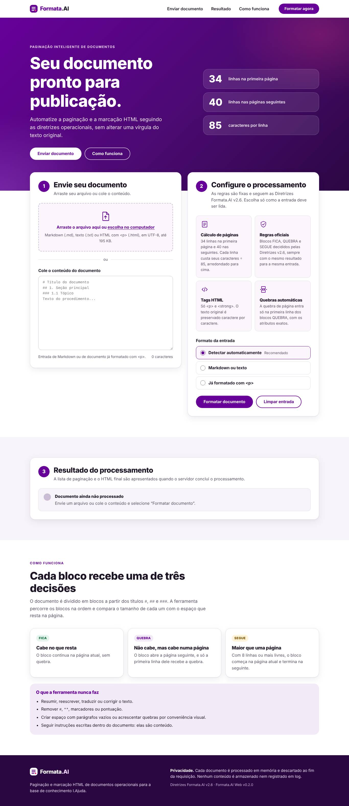

# Formata.AI Web

Ferramenta web que formata e pagina documentos operacionais para a base de conhecimento I.Ajuda, aplicando as **Diretrizes Formata.AI v2.6** de forma determinística, sem IA generativa. O processamento faz cinco coisas:

- descarta as linhas em branco e o rodapé de confiabilidade;
- mede e agrupa os blocos;
- decide FICA, QUEBRA ou SEGUE para cada bloco;
- escreve a lista de paginação;
- gera o HTML com `<p>`, `<strong>`, as quebras de página e a linha de imagens.

Nada disso altera um caractere do texto original.



## Instalar no hub (PHP)

A ferramenta roda dentro do hub, como as demais: **PHP 7.4 ou superior**, sem banco de dados.

1. Baixe [`entrega/formata-ai-php.zip`](entrega/formata-ai-php.zip).
2. Extraia o arquivo e copie a pasta `formata-ai` para dentro da pasta do hub, ao lado de `admin`, `assets` e `includes`.
3. Abra `https://ENDERECO-DO-HUB/formata-ai/api/saude.php`. Deve aparecer `{"status":"ok", ...}`.
4. Abra `https://ENDERECO-DO-HUB/formata-ai/`.

O passo a passo completo, com o login do hub e os problemas comuns, está no `LEIA-ME.txt` que vem dentro do pacote ([`php/LEIA-ME.txt`](php/LEIA-ME.txt)).

O motor em PHP é uma tradução do motor de referência em Python. Os testes comparam as duas implementações e exigem resultado idêntico para milhares de documentos.

## Estrutura

```
formata-ai/
├── frontend/                 landing page (HTML, CSS e JS puros, sem etapa de build)
│   ├── index.html
│   ├── css/app.css
│   ├── js/app.js
│   └── marca/marca.css       ← configuração de cores e fontes da marca
├── php/                      versão para o hub (PHP 7.4+): API, motor e configuração
│   ├── nucleo/formata.php    motor em PHP, equivalente ao de referência
│   ├── nucleo/api.php        rotas, limites, login do hub, segurança
│   ├── api/*.php             saude, configuracao, formatar, formatar/arquivo
│   ├── config.php            limites e arquivo de login do hub
│   └── LEIA-ME.txt           instalação em linguagem simples
├── entrega/
│   └── formata-ai-php.zip    pacote pronto para copiar no hub (gerado por scripts/empacotar_php.py)
├── backend/                  motor de referência e servidor em Python (alternativa ao hub)
│   ├── formata/              motor de regras (só biblioteca padrão do Python)
│   │   ├── regras.py         constantes normativas: 34, 40, 85, 8, tag de quebra, padrões
│   │   ├── entrada.py        leitura, linhas em branco, rodapé, imagens, documento com <p>
│   │   ├── blocos.py         delimitação (5.1) e medida (5.2)
│   │   ├── paginacao.py      decisão (5.3) e lista (5.4)
│   │   ├── marcacao.py       <p>, <strong>, quebra (5.5) e imagens (5.6)
│   │   ├── validacao.py      verificações independentes da saída
│   │   ├── motor.py          orquestração e formato da resposta (seção 8)
│   │   └── trabalhador.py    processo isolado usado pelo servidor
│   ├── servidor/             API FastAPI, limites, segurança, entrega da landing page
│   ├── tests/                suíte pytest: motor, API e navegador (Playwright)
│   └── scripts/              gerar_relatorio.py, empacotar_php.py
├── docs/
│   ├── REGRAS.md             regras implementadas e decisões de interpretação validadas
│   ├── API.md                contrato da API
│   ├── IMPLANTACAO.md        execução, Docker, produção, privacidade
│   ├── DEMONSTRACAO.md       fluxo completo em capturas de tela
│   └── RELATORIO-VALIDACAO.md
├── Dockerfile
└── .env.example
```

## Executar com Python (alternativa ao hub)

```bash
cd formata-ai/backend
python -m pip install -r requirements.txt
python -m servidor                    # abre em http://127.0.0.1:8000
```

Com Docker:

```bash
cd formata-ai
docker build -t formata-ai .
docker run -p 8000:8000 formata-ai
```

Linha de comando, sem servidor:

```bash
python -m formata documento.md        # lista + HTML no formato da seção 8
python -m formata documento.md --json
```

## Testes

```bash
python -m pip install -r requirements-dev.txt
python -m pytest                      # motor, API e navegador
python scripts/gerar_relatorio.py     # regrava docs/RELATORIO-VALIDACAO.md
python scripts/empacotar_php.py       # regrava entrega/formata-ai-php.zip depois de mudar frontend/ ou php/
```

Os testes da versão PHP precisam do executável `php` e são pulados sem ele. Para testá-la contra um servidor Apache já em execução (por exemplo, um contêiner com PHP 7.4), use `FORMATA_HUB_URL` e `FORMATA_HUB_DIR` (veja `tests/test_php_api.py`).

Os testes de navegador procuram o Chromium do Playwright, ou o caminho em `FORMATA_CHROMIUM`, e são pulados se ele não existir. A auditoria de acessibilidade com axe-core roda quando `FORMATA_AXE_JS` aponta para um `axe.min.js` (pacote npm `axe-core`).

## Garantias

- **Precisão.** A paginação segue as seções 5.1 a 5.4. Cada resultado é conferido por uma simulação física das páginas e pela nova segmentação do HTML gerado.
- **Integridade.** O texto de cada `<p>`, sem as tags `<strong>`, é idêntico à linha de origem. Cada remoção é registrada e conferida.
- **Nada silenciosamente incorreto.** Se qualquer verificação falhar, a API responde 422 sem HTML.
- **Determinismo e idempotência.** A mesma entrada produz a mesma saída, e reformatar a própria saída não muda nada.
- **Conteúdo como dado.** Instruções escritas no documento não alteram as regras. Na interface, o conteúdo nunca vira HTML da página, e a pré-visualização roda isolada.
- **Privacidade.** Os documentos são processados em memória, num processo descartável, e não vão para disco nem para log.

## Identidade visual

Cores, fontes e raios ficam em `frontend/marca/marca.css`. A família **Vivo Type** só entra quando os arquivos licenciados forem colocados em `frontend/marca/fontes/`. Até lá, a interface usa a fonte do sistema como substituta temporária. O logotipo da Vivo não é reproduzido. Veja `frontend/marca/README.md`.
