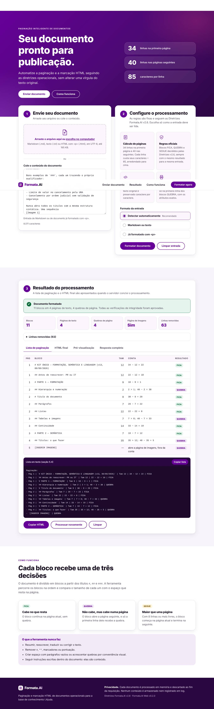
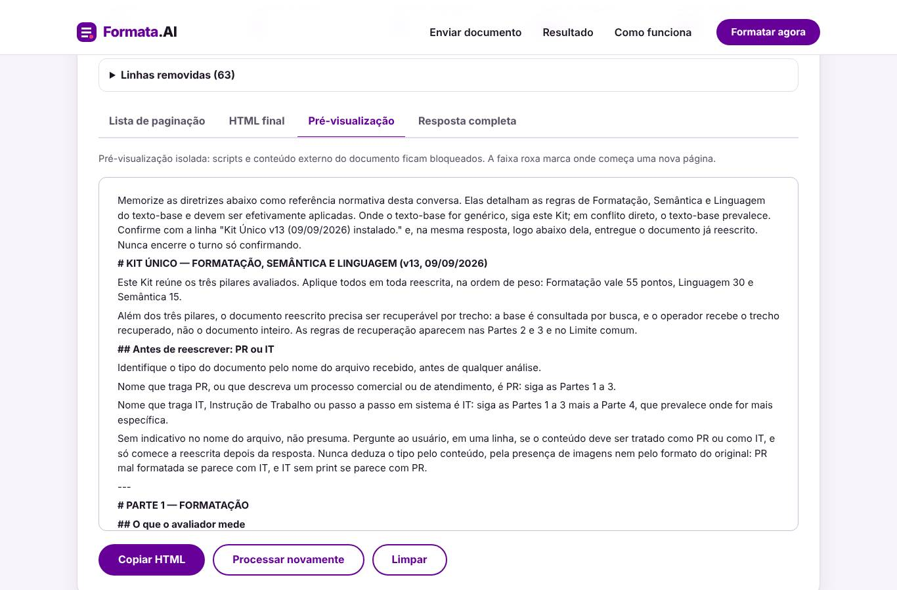

# Demonstração do fluxo completo

As capturas abaixo são geradas pelos testes de navegador (`tests/test_interface.py`) contra o servidor real, com o documento `tests/fixtures/kit_unico_v13.md`. Para regravá-las:

```bash
cd formata-ai/backend
FORMATA_CAPTURAS=../docs/demo python -m pytest tests/test_interface.py
```

## 1. Entrada

A página abre no estado "Documento ainda não processado". Há duas formas de entrada: enviar o arquivo, arrastando-o ou escolhendo-o no computador, ou colar o conteúdo no campo de texto. As regras aparecem como informação fixa. O usuário escolhe só como a entrada deve ser lida (automático, Markdown ou já formatado com `<p>`).


## 2. Cálculo de paginação e geração das tags

O botão "Formatar documento" envia a entrada ao servidor e mostra "Processando no servidor…". O resultado só aparece depois que o servidor responde. Ele traz:

- o resumo: blocos, páginas, quebras, página de imagens e linhas removidas;
- as linhas removidas, cada uma com o motivo;
- a lista de paginação: Pág, bloco, Tam, conta e resultado FICA, QUEBRA ou SEGUE;
- a mesma lista em texto, no formato da seção 5.4, pronta para copiar.



## 3. Apresentação do resultado

As abas mostram o HTML final, a pré-visualização e a resposta completa (seção 8). A pré-visualização roda num quadro isolado, em que scripts e recursos externos citados no documento ficam bloqueados. Uma faixa roxa marca cada nova página.



## 4. Celular

O mesmo fluxo, numa tela de 390 px de largura, sem rolagem horizontal. As tabelas e o código rolam dentro da própria área.


